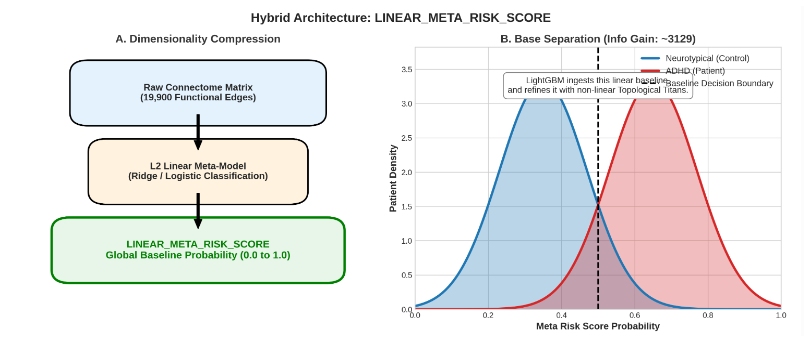
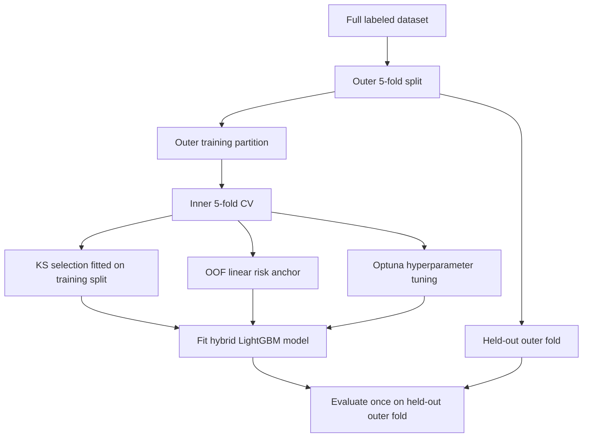
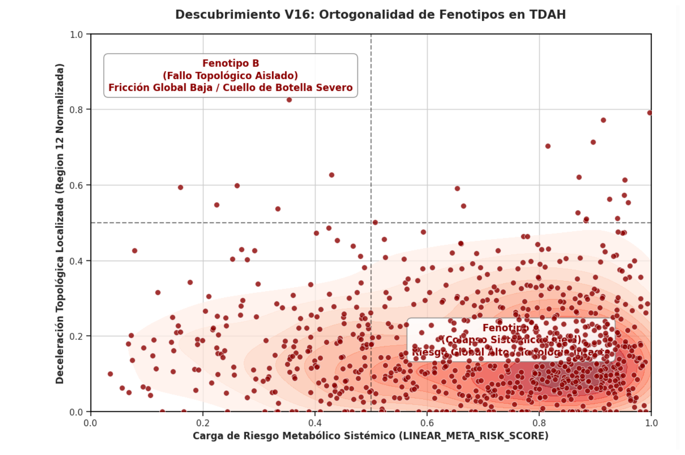
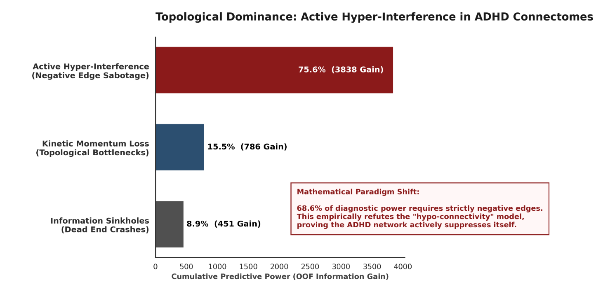

# Signed-Graph Topological Features for rs-fMRI Connectome Classification

**A leakage-controlled hybrid model for ADHD-versus-control classification from resting-state functional connectivity.**

> **Research access.** The full training codebase and labeled clinical dataset remain private under ongoing research and confidentiality restrictions. Institutional validation documentation and a technical walkthrough are available to admissions committees and academic reviewers upon request.

## Executive summary

This study addresses binary ADHD-versus-control classification using only 19,900 continuous Pearson-correlation edges from each 200 × 200 connectome, with no behavioral scores, demographic variables, clinical metadata, or anatomical atlas labels. The mean between-cohort edge difference is just 0.0021 (maximum 0.0154), against a typical fMRI noise floor of approximately 0.015; conventional flat/tabular models plateau around 0.60–0.63 ROC-AUC. To address this low-SNR regime, the proposed hybrid architecture pairs an out-of-fold L2-regularized linear anchor with higher-order signed-graph descriptors refined by LightGBM. The pipeline achieves **0.7164 mean outer-fold ROC-AUC** in strict **5×5 nested cross-validation**—an 8.64–11.64 percentage-point gain over that baseline range. This is a methodological advance in high-dimensional connectome modeling, not a standalone clinical diagnostic tool.

## Problem formulation and signal-to-noise barrier

- **Input:** Each subject's symmetric 200 × 200 whole-brain Pearson correlation matrix, represented by its strict upper triangle: 19,900 continuous edge features. The CSV feature columns run from `0throw_1thcolumn` through `198throw_199thcolumn`.
- **Target:** Binary `ADHD_Outcome` (1 = ADHD, 0 = control) in the labeled study. The public sample has no target labels.
- **Operating blind:** No behavioral questionnaires, clinical or demographic metadata, or anatomical atlas mappings; ROI indices 0–199 remain anonymous.
- **Cohort-level edge differences:** Mean absolute difference 0.0021; maximum single-edge difference 0.0154 (Pearson *r*), against a typical fMRI baseline noise floor of approximately 0.015.
- **Classical baseline:** Conventional flat/tabular models and isolated global graph metrics plateau around 0.60–0.63 ROC-AUC on pure rs-fMRI.

*Figure 1. Cohort mean connectomes and edge-weight distributions show the small 0.0021 mean absolute edge shift and 0.0154 maximum shift that define the low-SNR classification challenge.*

## Core engineering matrix

| Problem bottleneck | Failure mode of standard pipelines | Engineered solution |
|---|---|---|
| 19,900 edges and a comparatively small subject cohort (*p* ≫ *n*) | High dimensionality encourages overfitting and makes isolated edge effects unstable. | Fold-contained KS feature selection, nested validation, and regularized linear compression. |
| Between-cohort edge differences are near the noise floor | A single edge or global average misses distributed and localized structure. | Preserve signed edges and engineer higher-order graph descriptors. |
| Global linear signal coexists with localized non-linear patterns | Linear models miss interactions; a single tree can partition a continuous score coarsely. | Supply an out-of-fold linear risk anchor and localized graph features to LightGBM for non-linear refinement. |
| Standard positive-only thresholds or absolute-value transforms remove edge signs | Sign-dependent predictive structure is discarded or collapsed into unsigned magnitudes. | Retain edge signs and quantify negative-edge-dependent OOF Information Gain. |

## Methodology: signed-graph descriptors and hybrid architecture

Each subject's connectome is reconstructed as a signed weighted graph, from which four higher-order descriptors are engineered: **Signed Triadic Frustration, Kinetic Flow Deceleration, Dead-End Crash, and Inhibitory Mass**. Inspired by network dynamics and physics, these signed-graph topological descriptors capture structure lost when correlation matrices are flattened or edges are thresholded; they are mathematical abstractions, not established neurobiological mechanisms.

| Descriptor family | Computational interpretation |
|---|---|
| **Signed triadic frustration** | For a closed triangle, a negative product `W_AB × W_BC × W_CA < 0` flags signed imbalance. |
| **Kinetic flow deceleration** | A shortest-path / resistance-style descriptor quantifying multi-hop detours around low-weight bottlenecks. |
| **Dead-end crash / directional asymmetry** | A graph descriptor for nodes with strong positive inbound connectivity and weak or negative outbound connectivity. |
| **Inhibitory mass / antagonism** | Cumulative negative-edge magnitude around nodes or subsystems, rather than averaging positive and negative edges together. |

The `LINEAR_META_RISK_SCORE` is an L2-regularized Ridge/Logistic Regression meta-estimator over the edge space. It compresses the edge information to a continuous 0–1 baseline probability and is generated out-of-fold. LightGBM combines this anchor with localized topological features.

For the mathematical definitions available and implementation details not included in this showcase, see [Methodology notes](docs/METHODOLOGY.md).

<table>
<tr>
<td align="center"> <em>Triangle edge signs determine whether the signed product is positive or negative.</em></td>
<td align="center"> <em>Weaker direct edges redirect shortest paths through multi-hop alternatives.</em></td>
</tr>
<tr>
<td align="center"> <em>Inbound and outbound edge patterns define the directional-asymmetry descriptor.</em></td>
<td align="center"> <em>Cumulative negative-edge magnitude distinguishes signed neighborhoods.</em></td>
</tr>
</table>

*Figure 2. The L2 linear anchor compresses 19,900 edges into an out-of-fold 0–1 score; LightGBM combines that global baseline with localized topological features.*

*Figure 3. The displayed boundaries contrast linear, single-tree, and LightGBM hybrid decision surfaces over the global score and Region 12 deceleration.*

## Zero-leakage 5×5 nested cross-validation

KS feature selection is fitted only within training folds. In each outer-training partition, 5-fold inner CV generates the linear anchor out-of-fold and tunes LightGBM hyperparameters with Optuna; the untouched outer fold is reserved for evaluation.

| Outer fold | ROC-AUC |
|---:|---:|
| 1 | 0.7259 |
| 2 | 0.7212 |
| 3 | 0.6961 |
| 4 | 0.7441 |
| 5 | 0.6948 |
| **Mean** | **0.7164** |

<strong>View raw 5×5 Nested CV execution log</strong>

 

## Empirical results and key computational findings

### Top features by OOF Information Gain

| Rank | Feature | OOF Information Gain |
|---:|---|---:|
| 1 | `LINEAR_META_RISK_SCORE` | 3129.29 |
| 2 | `Region_12_Deceleration` | 412.44 |
| 3 | `Region_163_Deceleration` | 374.16 |
| 4 | `Region_138_Frustration` | 299.23 |
| 5 | `Region_1_Frustration` | 263.90 |
| 6 | `Region_22_Frustration` | 242.75 |
| 7 | `Region_36_Inhibitory` | 198.26 |
| 8 | `Region_100_Frustration` | 178.02 |
| 9 | `Region_66_DeadEndCrash` | 177.28 |
| 10 | `Region_106_Antagonism` | 174.64 |

Regions 17, 132, and 151 recur across multiple descriptor families in the Top 30.

### Topological Information Gain breakdown

| Descriptor group | Share | OOF Information Gain |
|---|---:|---:|
| Negative-edge / interference descriptors | 75.6% | 3838 |
| Kinetic deceleration / bottlenecks | 15.5% | 786 |
| Dead-end / directional asymmetry | 8.9% | 451 |

**Negative-edge dominance — 68.6%.** Over two-thirds of topological OOF Information Gain strictly requires negative edges. Positive-only thresholding therefore discards most of this predictive component, while absolute-value transforms erase the sign distinctions that define it.

### L-shaped geometric orthogonality

The `LINEAR_META_RISK_SCORE` versus `Region_12_Deceleration` distribution forms an L-shape rather than a linear diagonal. High global risk can coexist with low localized deceleration, while severe localized deceleration also appears at lower global risk. This complementary geometry motivates the hybrid design: a linear model misses localized departures from the global trend, while a single tree partitions the continuous score coarsely; LightGBM can refine the anchor using localized non-linear features.

*Figure 4. The score-versus-deceleration distribution displays the L-shaped relationship between global linear risk and localized Region 12 structure.*

*Figure 5. Negative-edge/interference descriptors contribute 75.6% of topological OOF Information Gain, followed by bottleneck and directional-asymmetry descriptors.*

*Figure 6. Region 66 inbound and outbound edge-weight distributions illustrate the directional-asymmetry descriptor in the signed-graph representation.*

## Input data schema

[`data/sample_connectomes.csv`](data/sample_connectomes.csv) contains 20 subjects × 19,901 columns: one `participant_id` column and 19,900 edge features. The file is 7.72 MiB (8,097,127 bytes), contains 0 missing values, and its Pearson *r* values range from -0.2845 to 0.4885 (mean 0.0046; standard deviation 0.0467).

| Sample row | `0throw_1thcolumn` | `0throw_2thcolumn` | `198throw_199thcolumn` |
|---:|---:|---:|---:|
| 1 | 0.093473 | 0.146902 | 0.143372 |
| 2 | 0.029580 | 0.179323 | 0.138200 |
| 3 | -0.051580 | 0.139734 | 0.162162 |

The preview omits participant identifiers. The complete clinical dataset and target labels are not included.

## Limitations and future work

- **Clinical scope:** The 0.7164 ROC-AUC is a methodological result, not a standalone diagnostic tool or evidence of clinical utility.
- **Anatomical mapping:** ROI indices 0–199 are anonymous; mapping them to standard anatomical atlases is an important next step.
- **Scientific interpretation:** The descriptors are computational hypotheses inspired by network dynamics, not demonstrated neural mechanisms or causal explanations; external clinical validation is required.
- **Generalization:** Independent cohorts and multi-site harmonization are needed to assess transportability.
- **Reproducibility boundary:** The full training codebase and labeled dataset remain private under ongoing research and confidentiality restrictions.

## Validation and review access

Institutional validation documentation and a technical walkthrough are available to admissions committees and academic reviewers upon request via GitHub.
