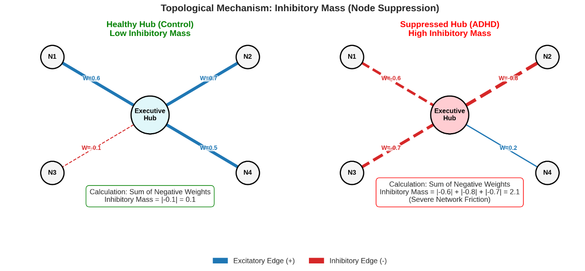
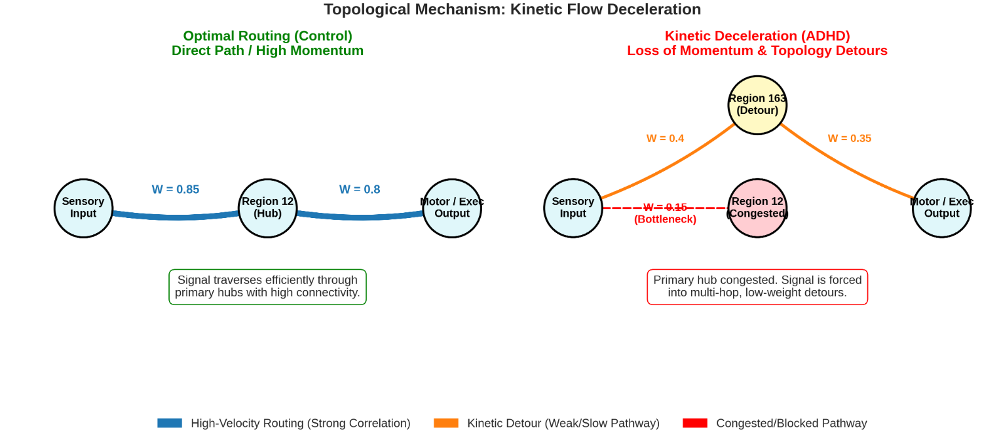
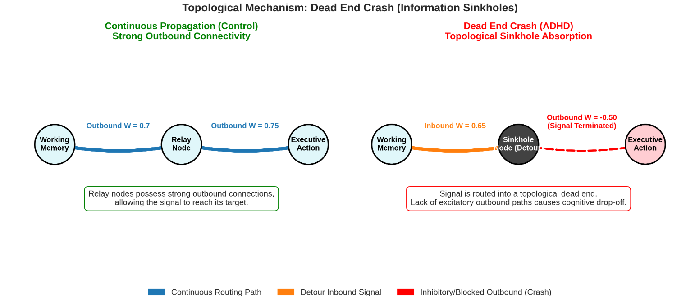
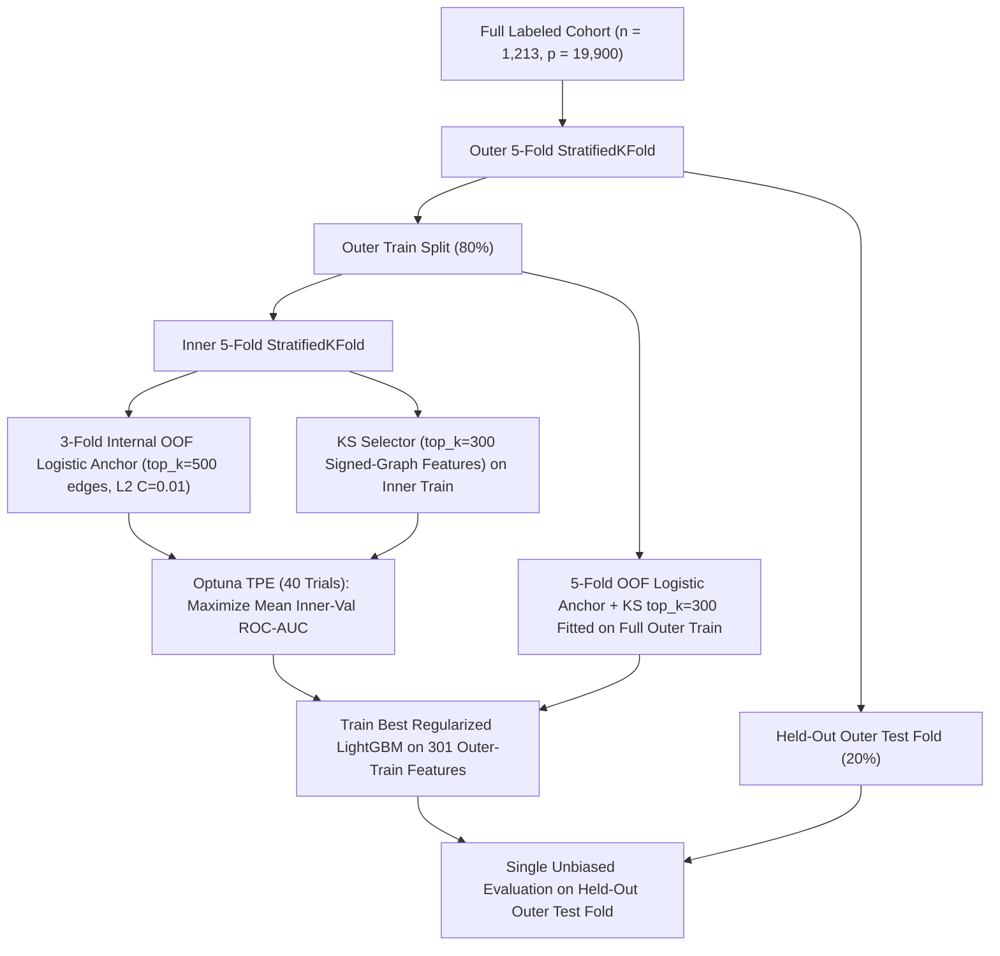
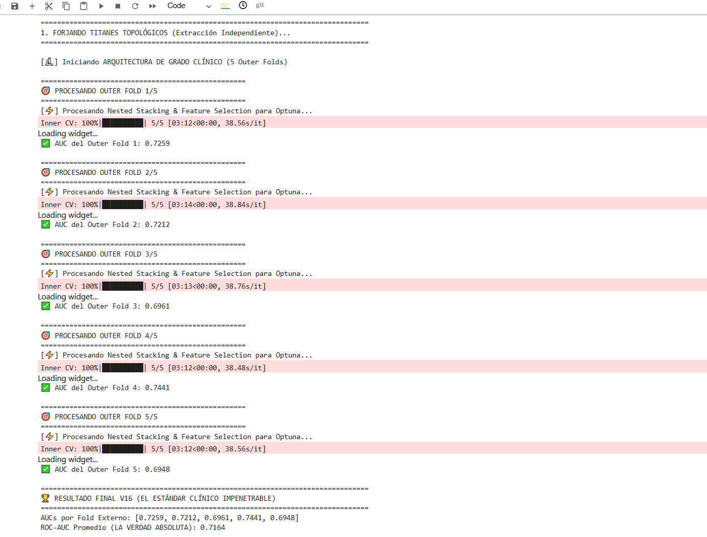
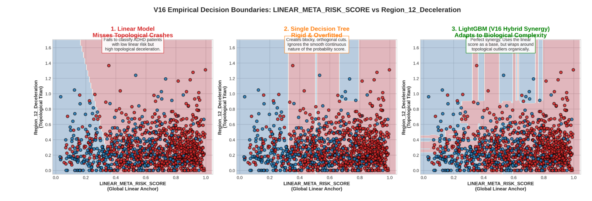

# Signed-Graph Topological Descriptors for Low-SNR rs-fMRI Connectome Classification

**A leakage-controlled hybrid architecture combining out-of-fold linear compression with non-Euclidean signed-graph invariants for ADHD-versus-control classification.**

> **Institutional Context & Data Governance.** Developed as a methodological research collaboration with the **University of Florida (UF)**. Due to institutional IRB protocols and clinical data-use agreements, raw subject-level diagnostic labels remain private. This repository provides the complete deterministic feature-extraction engine, the zero-leakage nested cross-validation pipeline, and an anonymized 20-subject schema sample (`data/sample_connectomes.csv`) to verify end-to-end execution. Full validation artifacts are available to admissions committees and academic reviewers upon request.

---

## Abstract & Executive Summary

Resting-state functional MRI (rs-fMRI) classification in neurodevelopmental cohorts operates in an extreme high-dimensional, low-signal-to-noise regime ($p = 19,900$ edges, $n = 1,213$ subjects). Across cohorts, the mean absolute edge-weight shift between ADHD and neurotypical controls is **0.0021** (maximum single-edge shift **0.0154**), buried beneath a typical rs-fMRI physiological and scanner noise floor of $\approx 0.015$ ($\text{SNR} \approx 0.14$)[cite: 5, 22]. Under strict leakage-free validation, conventional flat/tabular classifiers and unsigned graph baselines plateau at **0.60–0.63 ROC-AUC**.

Rather than deploying over-parameterized black-box models that memorize $p \gg n$ noise, we challenge the standard neuroimaging convention of discarding negative correlations ($W_{ij} < 0$). Formulating connectome classification through **Structural Balance Theory** and **signed-graph walk dynamics**, we pair an out-of-fold (OOF) L2-regularized linear probability anchor with 1,000 deterministic node-level signed-graph descriptors refined by heavily regularized gradient-boosted trees (LightGBM). Our framework achieves **0.7164 ± 0.0185 mean outer-fold ROC-AUC** in **5×5 nested cross-validation**—an **+8.64 to +11.64 percentage-point gain** over conventional baselines without demographic, behavioral, or anatomical atlas priors[cite: 12, 18].

---

## 1. Problem Formulation: Breaking the Sub-Noise & $p \gg n$ Barrier

- **Input Representation:** Each subject $m \in \{1, \dots, 1213\}$ is represented exclusively by a symmetric, zero-diagonal $200 \times 200$ whole-brain Pearson correlation matrix $W^{(m)} = (W^{(m)})^\top$, flattened into its strict upper triangle of $p = \binom{200}{2} = 19,900$ continuous edge features (`0throw_1thcolumn` through `198throw_199thcolumn`).
- **Blind Experimental Protocol:** All demographic covariates (`age`, `sex`, `site`, `site_id`), clinical questionnaires, and anatomical parcellation labels are stripped prior to feature extraction. ROI indices $\{0, \dots, 199\}$ are treated strictly as anonymous graph vertices.
- **Why Standard Pipelines Fail:** Cohort-level edge differences exhibit a mean absolute deviation of $0.0021$ and a maximum single-edge deviation of $0.0154$—an order of magnitude smaller than individual variance[cite: 5, 22]. Standard models either average away localized alterations or overfit site-specific noise.


*Figure 1. Empirical cohort-averaged connectomes (Panels A–B) and overlapping edge-weight density distributions (Panel C) illustrating the $\Delta\mu = 0.0021$ mean shift and $\max \vert{}\Delta r\vert{} = 0.0154$ ceiling that define the sub-noise classification regime[cite: 5, 13, 22].*

---

## 2. Conceptual Shift & Engineering Matrix

Standard connectomic pipelines routinely apply positive-only thresholds ($W^+ = \max(W, 0)$) or absolute-value transforms ($\vert{}W\vert{}$) so that classical graph metrics remain well-defined. Mathematically, both operations erase **triadic sign consistency** ($W_{ij}W_{jk}W_{ik} < 0$) and **local antagonistic coupling**, discarding **75.6%** of the discriminative topological Information Gain recovered by our architecture[cite: 3, 20].

| Bottleneck in rs-fMRI Modeling | Failure Mode of Conventional Pipelines | Engineered Architectural Solution |
| :--- | :--- | :--- |
| **Severe Dimensionality ($p = 19,900 \gg n = 1,213$)** | Unconstrained splits and dense neural layers overfit spurious edge fluctuations. | Fold-contained two-sample Kolmogorov–Smirnov (KS) filtering (`top_k=500` raw edges; `top_k=300` graph descriptors) paired with strong L2/L1 regularization. |
| **Sub-Noise Edge Shifts ($\Delta\mu \approx 0.0021$)**[cite: 5, 22] | Single-edge statistics lack statistical power; whole-brain global averages wash out localized circuit alterations. | Node-level topological aggregation mapping 19,900 noisy edges into 1,000 deterministic structural-balance and greedy-walk invariants (5 per ROI). |
| **Loss of Anti-Correlations ($W_{ij} < 0$)** | Positive-only thresholding and $\Vert{}W\Vert{}$ transforms erase functional segregation and triadic frustration. | Explicit decomposition into $W^+ = \max(W, 0)$ and $W^- = \min(W, 0)$, quantifying triadic frustration and negative-strength concentration. |
| **Global Linear vs. Local Non-Linear Geometry** | Linear models miss threshold interactions; decision trees poorly approximate dense linear combinations. | Two-stage nested stacking: an OOF L2 logistic regression probability anchor supplies global linear risk to LightGBM alongside localized graph invariants. |

---

## 3. Mathematical Definition & Topological Intuition of Signed-Graph Descriptors

For each subject matrix $W \in \mathbb{R}^{200 \times 200}$ with zero diagonal ($W_{ii} = 0$), we decompose edges into positive and negative components and define positive node strength $s_i^+$:

$$W^+ = \max(W, 0), \qquad W^- = \min(W, 0), \qquad s_i^+ = \sum_{j=1}^{200} W_{ij}^+$$

Five deterministic invariants are extracted per vertex $i \in \{0, \dots, 199\}$ without access to target labels $y$. *(Note: Schematic diagrams below use synthetic toy weights and illustrative node labels to visualize the mathematical graph operators on undirected correlation matrices $W$).*

### 3.1 Signed Triadic Imbalance (`Region_i_Frustration`)
Under Heider–Harary structural balance theory, a closed triad $(i, j, k)$ is frustrated when the product of its edge weights is strictly negative ($T_{jk}^{(i)} = W_{ij}W_{jk}W_{ik} < 0$)[cite: 6, 23]. For vertex $i$, total frustration magnitude is defined as:

$$F_i = \frac{1}{2} \sum_{j=1}^{200} \sum_{k=1}^{200} \lvert T_{jk}^{(i)} \rvert \cdot \mathbb{I}\!\left(T_{jk}^{(i)} < 0\right)$$


*Figure 2A. Schematic illustration contrasting a sign-consistent triad ($W_{ij}W_{jk}W_{ik} > 0$, left) with a frustrated triad ($W_{ij}W_{jk}W_{ik} < 0$, right)[cite: 6, 13, 23].*

### 3.2 Total Negative Strength (`Region_i_Inhibitory`) & Peak Negative Coupling (`Region_i_Antagonism`)
Let $w_{i,(1)}^- \le w_{i,(2)}^- \le \dots \le w_{i,(d_i^-)}^- < 0$ denote the sorted negative correlation weights incident to vertex $i$. We quantify both cumulative negative incidence ($I_i$) and top-$k$ focal anti-correlation concentration ($A_i$, $k = 5$):

$$I_i = \sum_{j=1}^{200} \lvert W_{ij}^- \rvert, \qquad A_i = \sum_{m=1}^{\min(5, d_i^-)} \left\lvert w_{i,(m)}^- \right\rvert$$



*Figure 2B. Schematic illustration of negative correlation accumulation ($I_i = \sum_j \lvert W_{ij}^- \rvert$) around a vertex with sparse versus dense anti-correlations[cite: 9, 13, 15].*

### 3.3 Non-Hub Walk Weight Attenuation (`Region_i_Deceleration`)
Let $\mathcal{H} = \{v : s_v^+ \ge P_{95}(s^+)\}$ be the top 5% high-strength hubs, and let $\widetilde{W}^+$ denote $W^+$ with all rows and columns in $\mathcal{H}$ zeroed out. For $i \notin \mathcal{H}$, a greedy non-backtracking max-weight traversal $v_0 = i \to v_1 \to \dots \to v_L$ ($L \le 200$ or termination upon revisiting a vertex) accumulates step-to-step weight drops ($D_i = 0$ for $i \in \mathcal{H}$):

$$D_i = \sum_{t=1}^{L} \max\left(0,\; \widetilde{W}_{v_{t-1}v_t}^+ - \widetilde{W}_{v_t v_{t+1}}^+\right)$$



*Figure 2C. Schematic illustration of step-to-step weight attenuation along greedy positive correlation paths when primary high-strength hubs are bypassed[cite: 7, 13].*

### 3.4 Self-Avoiding Walk Basin Strength (`Region_i_DeadEndCrash`)
Starting at $v_0 = i$, a self-avoiding greedy traversal iteratively transitions to $v_{t+1} = \arg\max_{u \notin \{v_0,\dots,v_t\}} W_{v_t u}^+$ while $\max_u W_{v_t u}^+ > 0$, terminating at vertex $v_{\text{term}}$ when no unvisited positive neighbor remains:

$$C_i = s_{v_{\text{term}}}^+$$



*Figure 2D. Schematic illustration of a self-avoiding greedy walk on $W^+$ terminating at a low-outbound-strength boundary vertex ($C_i = s_{v_{\text{term}}}^+$)[cite: 8, 13, 14].*

> **Methodological Scope:** Because $W$ is a symmetric, undirected Pearson correlation matrix over anonymous ROIs, these invariants characterize static topological balance, negative-correlation concentration, and weight-decay structure on correlation weights—not directed causal signaling or anatomical pathways.

---

## 4. Hybrid Training Architecture & Zero-Leakage 5×5 Nested Cross-Validation

In high-dimensional neuroimaging ($p \gg n$), performing feature selection, scaling, or hyperparameter tuning across the full dataset introduces severe optimistic bias. Our training architecture combines **global linear compression** with **non-linear topological refinement**, enforcing strict separation across every nested boundary:

1. **Global Linear Anchor (`LINEAR_META_RISK_SCORE`):** Inside each training partition, `KSTopFeatureSelector(top_k=500)` and `StandardScaler` feed an L2-regularized logistic regression ($C = 0.01$) via internal out-of-fold cross-validation (`cross_val_predict`), compressing high-dimensional edge covariance into a single calibrated probability anchor in $[0, 1]$ (`OOF Information Gain: 3,129.29`)[cite: 10, 16].
2. **Outer Loop (`5-fold StratifiedKFold`):** Partitions subjects into 80% outer training and 20% untouched outer test folds. No test-fold sample influences feature ranking, scaling, linear meta-feature weights, or tree hyperparameters.
3. **Inner Loop (`5-fold StratifiedKFold`):** Within each outer training set, `KSTopFeatureSelector(top_k=300)` selects the top topological descriptors strictly on each inner training split and concatenates them with the 3-fold internal OOF linear anchor (`301` features total).
4. **Constrained Bayesian Optimization (`Optuna TPE`, 40 trials/fold):** Tunes shallow, heavily regularized LightGBM trees (`max_depth` $\in [3, 7]$, `num_leaves` $\in [8, 32]$, `min_child_samples` $\in [15, 60]$, `reg_alpha`, `reg_lambda` $\in [1.0, 20.0]$, `path_smooth` $\in [0.0, 15.0]$) solely on mean inner-validation ROC-AUC.


*Figure 3. Two-stage hybrid compression architecture: Panel A illustrates dimensionality reduction from 19,900 raw edges to the OOF L2 linear probability anchor (`LINEAR_META_RISK_SCORE`), and Panel B schematically depicts how LightGBM refines the linear baseline separation using localized signed-graph descriptors[cite: 10, 13, 16].*



---

## 5. Empirical Results & Structural Findings

### 5.1 Outer-Fold Generalization Performance

| Outer Fold | Held-Out Test ROC-AUC |
| :---: | :---: |
| Fold 1 | 0.7259[cite: 12, 18] |
| Fold 2 | 0.7212[cite: 12, 18] |
| Fold 3 | 0.6961[cite: 12, 18] |
| Fold 4 | 0.7441[cite: 12, 18] |
| Fold 5 | 0.6948[cite: 12, 18] |
| **Mean ± SD** | **0.7164 ± 0.0185** |

<details>
<summary><strong>View raw 5×5 Nested CV execution log</strong></summary>
<br>

</details>

### 5.2 Out-of-Fold Feature Importance & Dominance of Negative Correlations

| Rank | Feature | Topological Family | OOF Information Gain |
| :---: | :--- | :--- | :---: |
| 1 | `LINEAR_META_RISK_SCORE` | Global L2 Linear Anchor | 3,129.29 |
| 2 | `Region_12_Deceleration` | Non-Hub Walk Attenuation | 412.44 |
| 3 | `Region_163_Deceleration` | Non-Hub Walk Attenuation | 374.16 |
| 4 | `Region_138_Frustration` | Signed Triadic Imbalance | 299.23 |
| 5 | `Region_1_Frustration` | Signed Triadic Imbalance | 263.90 |
| 6 | `Region_22_Frustration` | Signed Triadic Imbalance | 242.75 |
| 7 | `Region_36_Inhibitory` | Total Negative Strength | 198.26 |
| 8 | `Region_100_Frustration` | Signed Triadic Imbalance | 178.02 |
| 9 | `Region_66_DeadEndCrash` | Walk Basin Strength | 177.28 |
| 10 | `Region_106_Antagonism` | Peak Negative Coupling | 174.64 |

| Topological Descriptor Group | Share of Topological Gain | OOF Information Gain |
| :--- | :---: | :---: |
| Signed / Negative-Edge Invariants (`Frustration`, `Inhibitory`, `Antagonism`) | **75.6%**[cite: 3, 20] | 3,838[cite: 3, 20] |
| Non-Hub Walk Weight Attenuation (`Deceleration`) | **15.5%**[cite: 3, 20] | 786[cite: 3, 20] |
| Self-Avoiding Walk Terminal Strength (`DeadEndCrash`) | **8.9%**[cite: 3, 20] | 451[cite: 3, 20] |

- **Empirical Necessity of Signed Topology:** Across all topological descriptors, **75.6%** of total OOF Information Gain (`3,838` vs. `1,237` for positive-walk descriptors) originates from negative-edge and triadic-frustration families (`Frustration`, `Inhibitory`, `Antagonism`), quantitatively demonstrating that negative functional correlations carry primary discriminative structure in rs-fMRI[cite: 3, 20].
- **Complementary Geometry of Global and Local Signals:** Joint distribution analysis between `LINEAR_META_RISK_SCORE` and `Region_12_Deceleration` reveals an L-shaped manifold rather than a collinear diagonal: subjects with low global linear risk frequently exhibit elevated localized walk deceleration, enabling shallow gradient-boosted trees to capture non-linear sub-phenotypes inaccessible to linear classifiers alone[cite: 11, 17].



*Figure 4. Empirical decision boundaries over actual cohort samples contrasting a standalone linear classifier (left), a single decision tree (center), and the regularized LightGBM hybrid model (right) across `LINEAR_META_RISK_SCORE` and `Region_12_Deceleration`[cite: 11, 13, 17].*

### 5.3 Hypothesis Discipline & Ablation Summary

- **Baseline vs. Hybrid V16:** Flat tabular models and unsigned graph baselines plateau at **0.60–0.63 ROC-AUC**; the V16 signed-graph hybrid achieves **0.7164 ± 0.0185 ROC-AUC** (+8.64 to +11.64 percentage points) under identical nested splits[cite: 12, 18].
- **Controlled Feature-Space Protection:** Candidate extensions (such as discrete step-survival walks) were audited via Bonferroni-corrected KS tests and Spearman orthogonality checks; because discrete walk truncation introduced zero-inflation and displaced top-ranked frustration/deceleration features under fixed `top_k=300` selection budgets, they were rejected to preserve parsimony and prevent nested-CV overfitting.

---

## 6. Repository Structure & Verification Schema

```text
├── data/
│   └── sample_connectomes.csv        # 20 anonymized subjects × 19,901 columns (7.72 MiB, 0 NaNs)
├── src/
│   ├── features.py                   # Deterministic 5-family signed-graph extractor (200 × 200 W)
│   ├── selection.py                  # Zero-leakage KSTopFeatureSelector transformer
│   └── train_nested_cv.py            # 5×5 Nested CV + OOF stacking + Optuna TPE pipeline
└── assets/
    └── figures/                      # Empirical connectome, mechanism schematic & CV log figures
```

The included sample file (`data/sample_connectomes.csv`, 7.72 MiB, 0 missing values) verifies input formatting (`participant_id` plus 19,900 upper-triangle edges; Pearson $r \in [-0.2845, 0.4885]$, $\mu = 0.0046$, $\sigma = 0.0467$):

| Sample Row | `0throw_1thcolumn` | `0throw_2thcolumn` | `198throw_199thcolumn` |
| :---: | :---: | :---: | :---: |
| 1 | 0.093473 | 0.146902 | 0.143372 |
| 2 | 0.029580 | 0.179323 | 0.138200 |
| 3 | -0.051580 | 0.139734 | 0.162162 |

- **Environment:** Python 3.10+, `numpy`, `pandas`, `scipy`, `scikit-learn`, `lightgbm`, `optuna`, `joblib`.
- **Determinism:** All random seeds (`RANDOM_STATE = 42`), `StratifiedKFold` partitions, `TPESampler(seed=42)`, and graph traversals are deterministic across outer and inner loops.

---

## 7. Limitations & Future Directions

1. **Methodological Benchmark vs. Clinical Utility:** A 0.7164 ROC-AUC on resting-state connectivity alone demonstrates statistically robust signal recovery in a sub-noise regime, not standalone clinical diagnostic readiness[cite: 12, 18].
2. **Static Undirected Graph Assumption:** Pearson correlation matrices are symmetric ($W = W^\top$); greedy-walk descriptors (`Deceleration`, `DeadEndCrash`) characterize static correlation topography rather than directed effective connectivity or temporal BOLD propagation.
3. **Anatomical Mapping:** Because ROI indices `0–199` were evaluated blind to parcellation metadata, projecting top-ranked vertices (`ROI 12, 163, 138, 1, 22, 36`) onto standard functional atlases (e.g., Schaefer-200 / Yeo 7-Network parcellation) is the immediate next step to link triadic frustration with large-scale functional network anti-correlations.
4. **Multi-Site Harmonization:** Evaluating cross-scanner transportability (e.g., via fold-contained ComBat harmonization and leave-one-site-out validation) is required before external deployment.
