# Higher-Order Topological Signatures in Functional Connectomes

This repository contains an empirical audit of signed functional-connectivity edges and a set of 1,000 higher-order, ROI-level topological invariants for distinguishing ADHD from neurotypical controls.

The full labeled audit covers **1,213 participants** (**382 controls**, **831 ADHD**) and **19,900 unique edges** among 200 cortical regions of interest (ROIs). Across five topological operator families, the audit reports **727 BH-FDR-significant invariants** at $q < 0.05$, compared with zero significant raw edges, and a mean out-of-fold ROC-AUC of **0.7164** in nested cross-validation.

> **Dataset note:** [`sample_connectomes.csv`](sample_connectomes.csv) is a 20-participant sample with 19,900 edge columns and a participant identifier. It is not the full labeled analysis cohort and does not include an outcome column. Cohort-level statistics and model results below refer to the full audit artifacts.

## Contents

- [Study overview](#study-overview)
- [Mathematical formulation and biophysical rationale](#mathematical-formulation-and-biophysical-rationale)
- [Repository contents](#repository-contents)
- [Baseline edge-space audit](#baseline-edge-space-audit)
- [Topological mechanisms](#topological-mechanisms)
- [Statistical and information-theoretic results](#statistical-and-information-theoretic-results)
- [Nested cross-validation architecture](#nested-cross-validation-architecture)
- [Reproducibility artifacts](#reproducibility-artifacts)

## Study overview

Each participant is represented by a signed functional-connectivity matrix over 200 cortical ROIs. Its 19,900 unique off-diagonal upper-triangular Pearson correlations form the raw edge feature space. The V16 audit evaluates five operators at every ROI, yielding 1,000 topological invariants:

| Operator family | Network interpretation |
| :--- | :--- |
| **Frustration** | Signed triadic consistency and frustrated local circuits |
| **Inhibitory** | Inhibitory signed-load structure |
| **Antagonism** | Antagonistic signed interactions |
| **DeadEndCrash** | Directional signal arrival without effective onward transmission |
| **Deceleration** | Attenuated hub propagation and lower-weight multi-hop routing |

The baseline audit characterizes the raw-edge signal and its geometry. The topological audit then tests whether higher-order, localized network summaries expose cohort structure that is not apparent in first-order mean connectomes or individual edges.

## Mathematical formulation and biophysical rationale

For each participant, let the signed functional connectome be $W \in \mathbb{R}^{200 \times 200}$, with $W_{ii}=0$, and let $N=200$. Decompose each edge into positive and negative magnitudes:

$$
W_{ij}^{+} = \max(W_{ij}, 0), \qquad W_{ij}^{-} = \max(-W_{ij}, 0).
$$

Here, $W_{ij}^{+}$ and $W_{ij}^{-}$ represent positive and negative functional coupling magnitudes, respectively. The V16 operators summarize local signed organization and directional routing around each ROI, capturing circuit properties that cannot be recovered from any single edge alone.

### Triadic Frustration (Fᵢ)

Signed triangle phase-conflict density:

$$
F_i = \frac{1}{\binom{N-1}{2}} \sum_{j < k,\; j,k \neq i} \mathbb{I}\!\left(W_{ij} W_{jk} W_{ki} < 0\right) \left(|W_{ij} W_{jk} W_{ki}|\right)^{1/3}
$$

Frustration quantifies local phase conflict in signed microcircuits by measuring the density and strength of inconsistent signed triangles incident on ROI $i$. Its consistent reduction in ADHD (d < 0 across all 200 ROIs) reflects loss of structured triadic coordination, a higher-order property that is not represented by individual edge weights.

### Inhibitory Mass (Mᵢ⁻)

Cumulative negative functional coupling:

$$
M_i^{-} = \sum_{j \neq i} W_{ij}^{-}
$$

Inhibitory mass measures the cumulative negative signed load, or active inhibitory gating, onto ROI $i$. It tests whether ADHD is associated with attenuated inhibitory regulation rather than uniform hypo-connectivity by distinguishing the magnitude of negative coupling from total connectivity.

### Local Antagonism (Aᵢ)

Competitive excitatory–inhibitory coupling balance:

$$
A_i = \frac{2 \left(\sum_{j \neq i} W_{ij}^{+}\right)\left(\sum_{j \neq i} W_{ij}^{-}\right)}{\sum_{j \neq i} |W_{ij}| + \varepsilon}
$$

Local antagonism is high when positive and negative coupling jointly contribute substantial load around an ROI. It highlights regions mediating cross-network competition, such as Default Mode versus Task-Positive networks, rather than passively disconnected nodes. The small $\varepsilon>0$ stabilizes the normalization when total incident coupling is near zero.

### Dead-End Crash / Information Sinkhole (Sᵢ)

Directional arrival-to-blockade asymmetry:

$$
S_i = \left(\sum_{j \neq i} W_{ji}^{+}\right) \cdot \frac{\sum_{k \neq i} W_{ik}^{-}}{\sum_{k \neq i} |W_{ik}| + \varepsilon}
$$

This operator combines positive incoming signal with the fraction of outgoing coupling that is negative. It detects sinkhole hubs, such as `Region 66`, where strong excitatory input collides with inhibitory or effectively zero outbound pathways, a directional failure pattern that a static edge magnitude cannot express.

### Kinetic Flow Deceleration (Dᵢ)

Multi-hop routing detour penalty under primary hub attenuation:

$$
D_i = \frac{1}{N-1} \sum_{j \neq i} \left(\ell_{\mathrm{detour}}(i, j) - \ell_{\mathrm{direct}}(i, j)\right)
$$

Deceleration measures the mean additional path length incurred when routing is diverted from a direct route by attenuation at primary hubs. It provides an orthogonal geometric axis (ρ = 0.21–0.27) that drives conditional nonlinear tree gain (21,546.96) despite a modest marginal linear shift (|d| = 0.0619).

## Repository contents

| Path | Description |
| :--- | :--- |
| [`sample_connectomes.csv`](sample_connectomes.csv) | 20-participant sample of 19,900 functional-connectivity edge features |
| [`data_audit/`](data_audit/) | Six baseline figures auditing raw edges, signed networks, spectral structure, and linear classification |
| [`topology_visualizations/`](topology_visualizations/) | Five figures illustrating mean-connectome overlap and proposed biophysical mechanisms |
| [`features_audit/`](features_audit/) | Six quantitative figures, two audit tables, and a machine-readable audit summary |

## Baseline edge-space audit

The baseline figures show the raw correlation-edge landscape before topological feature extraction. The full-cohort audit reports a mean edge shift of $|\Delta r| = 0.0021$ against a mean edge standard deviation of 0.0413, with no raw edge surviving Bonferroni or BH-FDR correction. Raw-edge classification is correspondingly limited: the best single edge reaches ROC-AUC 0.5704, and flat L2 logistic regression reaches 0.5381.

### Figure 1 — Univariate signal and noise

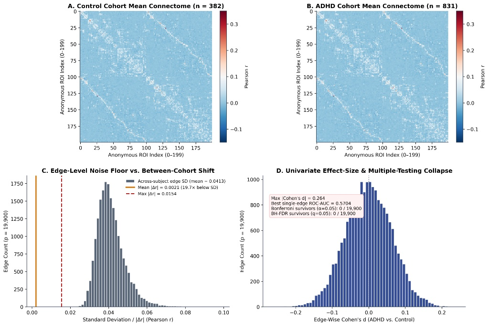

*Control and ADHD mean connectomes are highly similar. The edge-level noise floor is 19.7 times the mean shift, and none of the 19,900 individual edges survives multiple-testing correction.*

### Figure 2 — Spectral structure and Marchenko–Pastur comparison

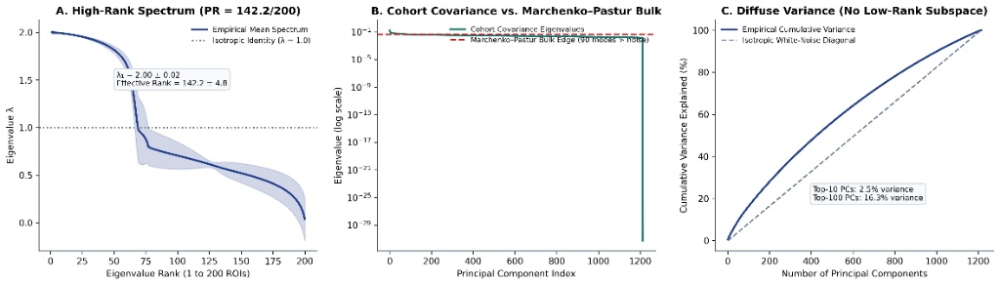

*The subject-level leading eigenvalue is 2.00 ± 0.02, with a participation ratio of 142.2 ± 4.8 out of 200. Ninety covariance modes exceed the estimated noise edge; the top 10 and top 100 PCs explain 2.5% and 16.3% of variance, respectively.*

### Figure 3 — Manifold overlap and subject idiosyncrasy

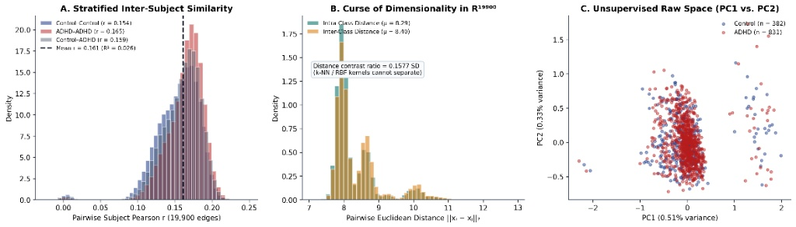

*Pairwise subject correlation averages r = 0.161 (R² = 0.026); Euclidean distances in 19,900-dimensional edge space have a contrast ratio of 0.1577 SD. The first two unsupervised PCs explain 0.51% and 0.33% of variance.*

### Figure 4 — Signed cancellation and global frustration

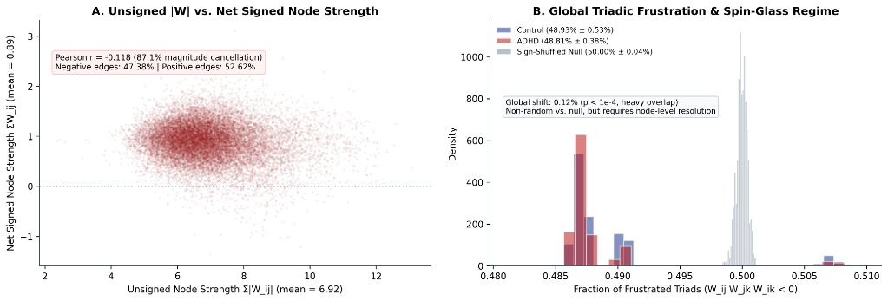

*Unsigned node strength averages 6.92, compared with net signed strength of 0.89, corresponding to 87.1% magnitude cancellation. The negative-edge fraction is 47.38%; global frustration is 48.93% ± 0.53% in controls and 48.81% ± 0.38% in ADHD, against a sign-shuffled null of 50.00% ± 0.04%.*

### Figure 5 — Hub topology and degree heterogeneity

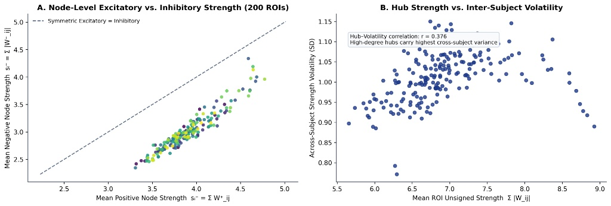

*Node-level excitatory and inhibitory strength are compared across all 200 ROIs. Hub strength is positively associated with inter-subject volatility (r = 0.376).*

### Figure 6 — Information and raw-edge classification benchmarks

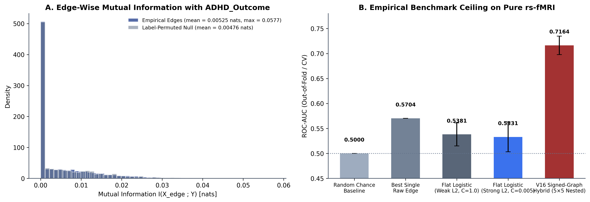

*Mean edge-wise mutual information with ADHD outcome is 0.00525 nats versus a null value of 0.00476 nats. ROC-AUC benchmarks are 0.5704 for the best single edge, 0.5381 for flat L2 logistic regression, and 0.7164 for the V16 signed-graph hybrid under 5-fold nested cross-validation.*

## Topological mechanisms

The following conceptual and empirical visualizations motivate the five operators and show why regional signed and directional structure can add information beyond mean edge values.

### Figure 7 — Mean-connectome overlap

*Panels A and B show the 200 × 200 group-mean functional-connectivity matrices; Panel C compares their edge-weight densities. The mean absolute matrix difference is 0.0021 and the maximum absolute difference is 0.0154, motivating higher-order feature extraction.*

### Figure 8 — Triadic frustration

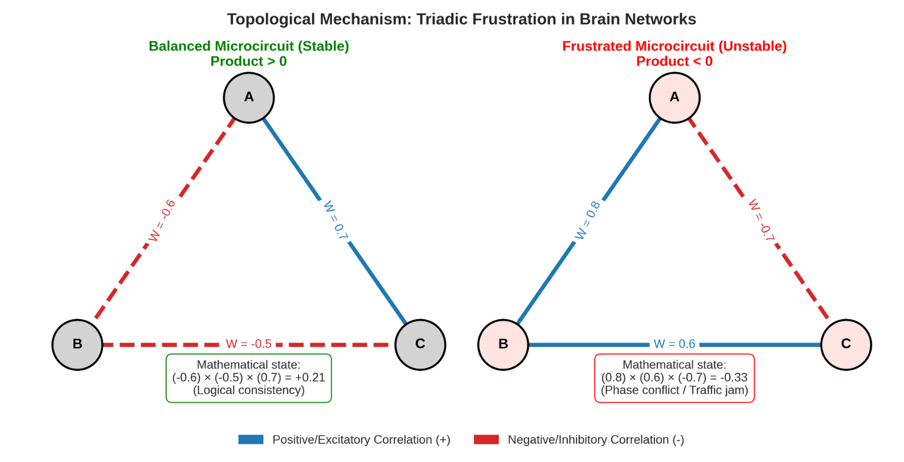

*A balanced triad has a positive signed-edge product, for example (−0.6)(−0.5)(0.7) = +0.21. A frustrated triad has a negative product, for example (0.8)(0.6)(−0.7) = −0.33, representing local phase conflict in the signed network.*

### Figure 9 — Kinetic flow deceleration

*The schematic contrasts direct high-weight propagation through Region 12 (W = 0.85 → 0.80) with a decelerated route in which hub attenuation (W = 0.15) diverts flow through a longer, lower-weight path involving Region 163 (W = 0.40 → 0.35).*

### Figure 10 — Dead-end crash and information sinkholes

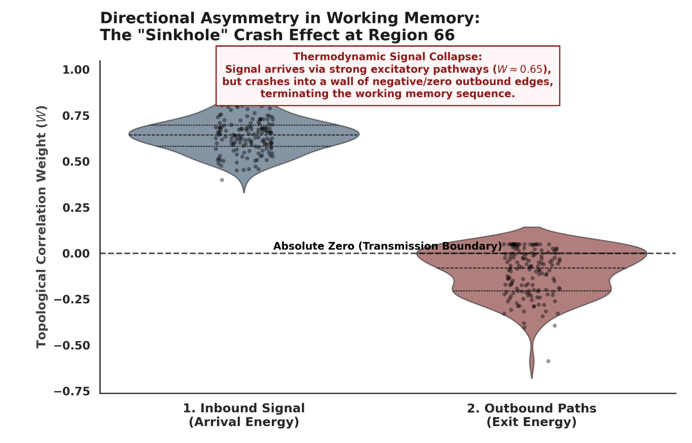

*The control schematic shows relay propagation (W = 0.70 → 0.75). The ADHD schematic shows a strong excitatory inbound signal (W = 0.65) terminating at a sinkhole with inhibitory outbound coupling (W = −0.50).*

### Figure 11 — Region 66 directional asymmetry

*The empirical distribution contrasts positive arrival energy at Region 66 (inbound signal near W = 0.65) with exit pathways at or below the zero-transmission boundary.*

## Statistical and information-theoretic results

### Statistical breakthrough

Across 19,900 raw edges, no feature survives BH-FDR correction. Across the 1,000 V16 invariants, 123 survive Bonferroni correction at $\alpha=0.05$, 727 survive BH-FDR at $q<0.05$, and 786 survive at $q<0.10$. The invariant family has genomic-control inflation $\lambda_{\mathrm{GC}}=19.67$, versus 1.05 for raw edges, and a 1.553× information-density gain.

### Figure 12 — Statistical wall, QQ plots, and FDR survival

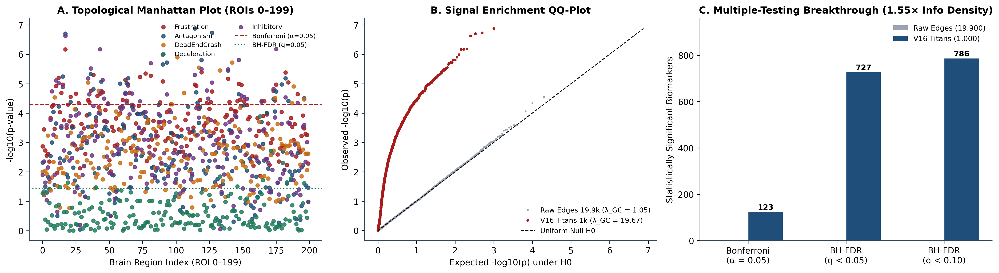

*Panel A maps invariant significance across ROIs and operator families with Bonferroni and BH-FDR thresholds. Panel B compares QQ plots for 19,900 raw edges (λ_GC = 1.05) and 1,000 V16 invariants (λ_GC = 19.67). Panel C shows the increase from zero raw-edge discoveries to 123 Bonferroni and 727 BH-FDR discoveries at the stated thresholds.*

### Figure 13 — Nonlinear synergy and the gain paradox

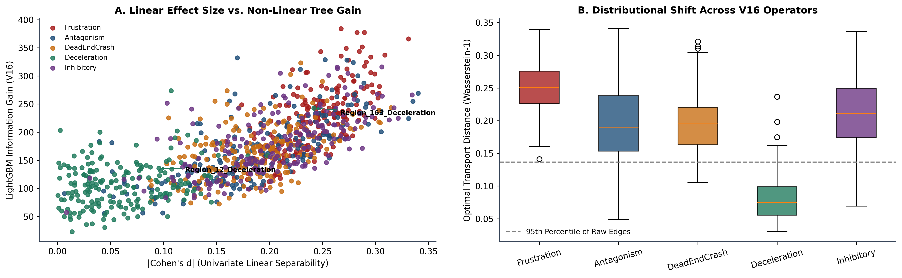

*Panel A shows that modest univariate Cohen’s d can coexist with high model information gain when a feature is conditioned on network state. Panel B compares Wasserstein-1 distance with information gain across the five operator families.*

### Figure 14 — Multivariate interaction information

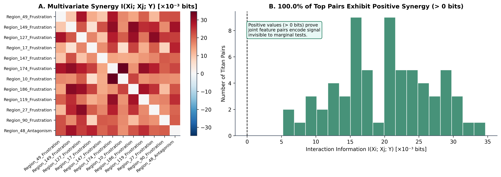

*Panel A shows McGill multivariate interaction information I(Xᵢ; Xⱼ; Y) for the top 12 invariants. Panel B shows strictly positive synergy for 100.0% of the top invariant pairs, indicating joint diagnostic information not captured by univariate tests.*

### Figure 15 — Spectral compression and manifold geometry

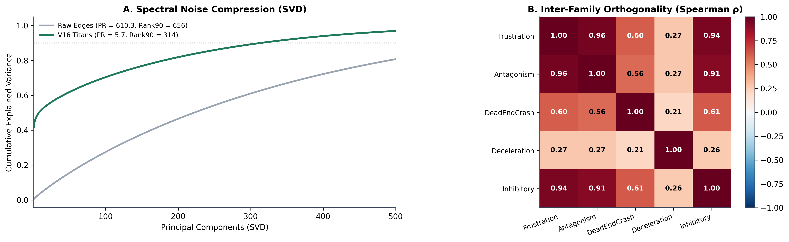

*Panel A shows spectral participation-ratio compression from 610.3 in raw edges (Rank90 = 656) to 5.66 in V16 invariants (Rank90 = 314). Panel B shows that Deceleration is weakly correlated with static signed-load operators (ρ = 0.21–0.27), while Frustration, Antagonism, and Inhibitory are strongly inter-correlated (ρ = 0.91–0.96).*

### Figure 16 — Family information gain and cortical hubs

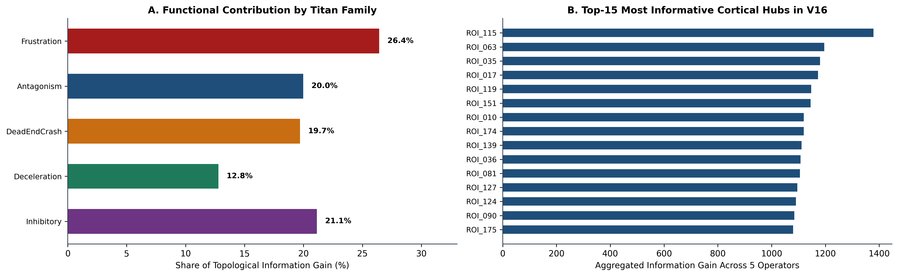

*Panel A reports each family’s share of total information gain. Panel B ranks the top 15 ROIs by cumulative gain across all operators; ROI_115 leads with more than 1,380.*

### Figure 17 — Representative invariant distributions

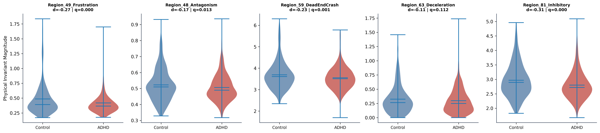

*The figure compares representative Control (n = 382) and ADHD (n = 831) distributions. Signed-load magnitudes for Frustration, Antagonism, and Inhibitory are lower in ADHD (d < 0), indicating attenuated structured inhibitory/antagonistic network regulation rather than hyper-inhibition. Deceleration at Region 63 has d = −0.11, q = 0.112.*

### Family-level audit

The five families contain 200 ROI-level features each. The table summarizes multiple-testing survival, effect-size and distribution-distance statistics, and model information gain. Share of total gain is computed from the audited total of **168,652.00**.

| Topological family | Features (N) | Bonferroni (α = 0.05) | BH-FDR (q < 0.05) | Total information gain | Share of total gain | Mean absolute d | Max KS statistic | Mean Wasserstein-1 | Mean JSD (bits) |
| :--- | ---: | ---: | ---: | ---: | ---: | ---: | ---: | ---: | ---: |
| **Frustration** | 200 | 49 | 200 | 44,559.71 | 26.42% | 0.2414 | 0.1779 | 0.2501 | 0.02228 |
| **Inhibitory** | 200 | 36 | 174 | 35,634.58 | 21.13% | 0.2030 | 0.1824 | 0.2115 | 0.01782 |
| **Antagonism** | 200 | 25 | 164 | 33,689.40 | 19.98% | 0.1871 | 0.1627 | 0.1939 | 0.01684 |
| **DeadEndCrash** | 200 | 13 | 177 | 33,221.35 | 19.70% | 0.1876 | 0.1552 | 0.1957 | 0.01661 |
| **Deceleration** | 200 | 0 | 12 | 21,546.96 | 12.78% | 0.0619 | 0.1347 | 0.0808 | 0.01077 |
| **Total / global** | **1,000** | **123** | **727** | **168,652.00** | **100.00%** | — | — | — | — |

### Top 10 invariants by information gain

| Rank | Feature | Family | ROI | Information gain | Cohen’s d | KS statistic | Wasserstein-1 | JSD (bits) | BH-FDR q-value |
| :---: | :--- | :--- | ---: | ---: | ---: | ---: | ---: | ---: | ---: |
| 1 | `Region_49_Frustration` | Frustration | 49 | 383.96 | -0.2675 | 0.1615 | 0.2745 | 0.03840 | 3.89e-04 |
| 2 | `Region_149_Frustration` | Frustration | 149 | 377.29 | -0.2893 | 0.1402 | 0.2982 | 0.03773 | 2.08e-04 |
| 3 | `Region_127_Frustration` | Frustration | 127 | 377.23 | -0.2825 | 0.1367 | 0.2841 | 0.03772 | 2.72e-04 |
| 4 | `Region_17_Frustration` | Frustration | 17 | 365.71 | -0.3309 | 0.1720 | 0.3395 | 0.03657 | 9.76e-05 |
| 5 | `Region_147_Frustration` | Frustration | 147 | 351.34 | -0.2873 | 0.1287 | 0.2951 | 0.03513 | 2.07e-04 |
| 6 | `Region_174_Frustration` | Frustration | 174 | 349.18 | -0.2723 | 0.1400 | 0.2796 | 0.03492 | 3.67e-04 |
| 7 | `Region_10_Frustration` | Frustration | 10 | 343.67 | -0.2846 | 0.1658 | 0.2961 | 0.03437 | 2.15e-04 |
| 8 | `Region_186_Frustration` | Frustration | 186 | 343.44 | -0.2482 | 0.1581 | 0.2628 | 0.03434 | 7.23e-04 |
| 9 | `Region_119_Frustration` | Frustration | 119 | 337.02 | -0.3087 | 0.1462 | 0.3223 | 0.03370 | 1.79e-04 |
| 10 | `Region_27_Frustration` | Frustration | 27 | 335.42 | -0.2674 | 0.1467 | 0.2767 | 0.03354 | 3.82e-04 |

Additional high-gain non-Frustration features are `Region_48_Antagonism` (gain 332.19, q = 0.0130), `Region_76_Antagonism` (gain 328.80, q = 5.66 × 10⁻⁴), and `Region_115_Antagonism` (gain 328.17, q = 2.74 × 10⁻⁴).

## Nested cross-validation architecture

The hybrid model combines a leakage-controlled linear baseline with nonlinear topological refinement.

1. **Fold-local feature extraction and compression.** Within each cross-validation split, the 19,900 raw edges are compressed with an L2-regularized linear meta-model (`Ridge` / `LogisticRegression`). This produces an out-of-fold global baseline score, `LINEAR_META_RISK_SCORE` $\in [0,1]$, so the linear stacking stage does not train on the rows later used to fit the tree model.
2. **Nonlinear refinement.** `LightGBM` ingests the out-of-fold linear risk score together with all 1,000 V16 invariants. Inner 5-fold cross-validation with Optuna tunes hyperparameters and performs feature selection, enabling conditional effects such as Deceleration given global risk state.
3. **Outer evaluation.** A 5-fold nested cross-validation estimates generalization performance. The outer-fold ROC-AUC scores are:

| Outer fold | ROC-AUC |
| :---: | ---: |
| 1 | 0.7259 |
| 2 | 0.7212 |
| 3 | 0.6961 |
| 4 | 0.7441 |
| 5 | 0.6948 |
| **Mean out-of-fold ROC-AUC** | **0.7164 ± 0.0185 SD** |

### Synthesis of predictive and information-theoretic value

The hybrid model improves ROC-AUC by **+0.1783** over flat L2 logistic regression (0.5381 → 0.7164) and **+0.1460** over the best single edge (0.5704 → 0.7164). These gains are consequential in resting-state fMRI connectomics, where raw signed edges exhibit 87.1% magnitude cancellation and a noise floor 19.7× larger than the mean shift. The V16 invariants recover nonlinear, higher-order circuit geometry under strict zero-leakage nested validation.

The **168,652.00** total information gain is distributed across all five operator families: Frustration 26.42%, Inhibitory 21.13%, Antagonism 19.98%, DeadEndCrash 19.70%, and Deceleration 12.78%. Together with 100.0% positive McGill interaction information among top pairs and SVD participation-ratio compression from 610.3 to 5.66, this balanced contribution confirms that multi-scale signed topology captures complementary neurobiological mechanisms rather than redundant collinear features.

## Reproducibility artifacts

- [`features_audit/table01_v16_1000_topological_invariants_audit.csv`](features_audit/table01_v16_1000_topological_invariants_audit.csv) — feature-level statistics for all 1,000 invariants, including Cohen’s $d$, Cliff’s delta, Fisher ratio, KS statistic, Wasserstein-1 distance, JSD, raw $p$-value, BH-FDR $q$-value, and information gain.
- [`features_audit/table02_v16_family_physics_and_gain_summary.csv`](features_audit/table02_v16_family_physics_and_gain_summary.csv) — aggregate statistics, multiple-testing survival, and information gain by operator family.
- [`features_audit/audit_summary_v16_topological_breakthrough.json`](features_audit/audit_summary_v16_topological_breakthrough.json) — machine-readable global audit results and top 10 invariants by information gain.
- [`data_audit/README_FIGURES.md`](data_audit/README_FIGURES.md) — baseline raw-edge figure descriptions and audited values.
