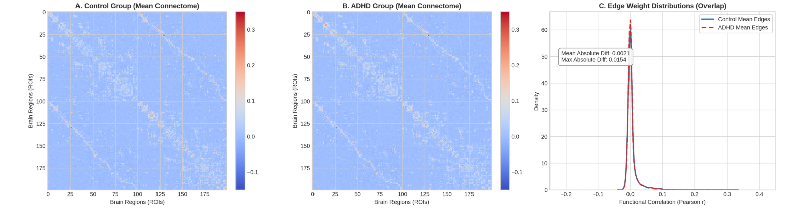
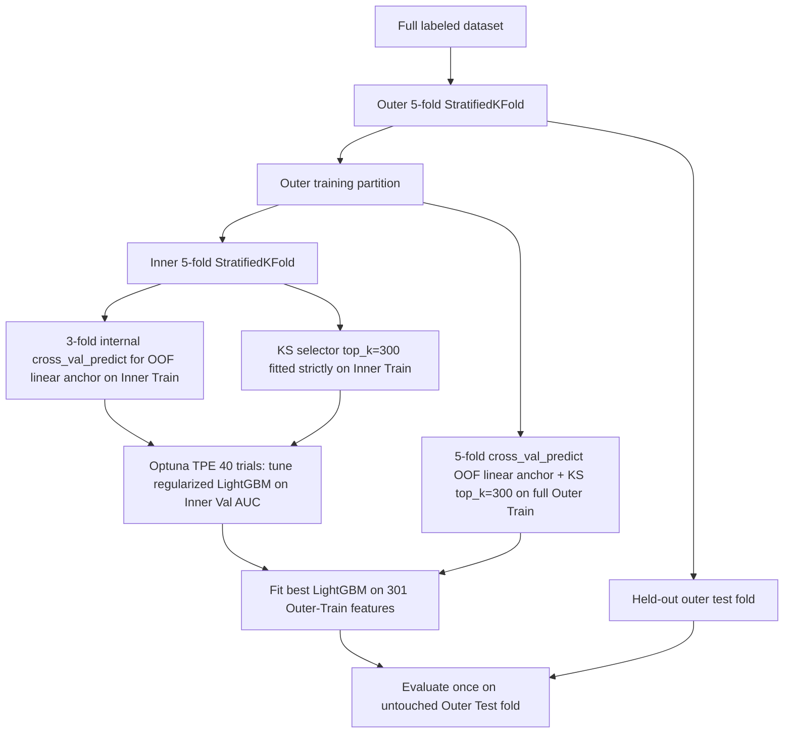

# Signed-Graph Topological Features for rs-fMRI Connectome Classification

**A leakage-controlled hybrid model for ADHD-versus-control classification from resting-state functional connectivity.**

> **Research access.** The labeled clinical dataset remains private under ongoing research and confidentiality restrictions. Institutional validation documentation and a technical walkthrough are available to admissions committees and academic reviewers upon request.

## Executive summary

This study addresses binary ADHD-versus-control classification using only 19,900 continuous Pearson-correlation edges from each symmetric 200 × 200 connectome, with no behavioral scores, demographic variables, clinical metadata, or anatomical atlas labels. The mean between-cohort edge difference is 0.0021 (maximum 0.0154), against a typical fMRI noise floor of approximately 0.015; conventional flat/tabular models plateau around 0.60–0.63 ROC-AUC. To address this low-SNR regime, the proposed hybrid architecture pairs an out-of-fold L2-regularized logistic regression anchor with five node-level signed-graph descriptors refined by LightGBM. The pipeline achieves **0.7164 mean outer-fold ROC-AUC** in strict **5×5 nested cross-validation**—an 8.64–11.64 percentage-point gain over that baseline range. This is a methodological study in high-dimensional connectome modeling, not a clinical diagnostic tool.

## Problem formulation and signal-to-noise barrier

- **Input:** Each subject's symmetric 200 × 200 whole-brain Pearson correlation matrix ($W = W^\top$, zero diagonal), represented by its strict upper triangle: 19,900 continuous edge features (`0throw_1thcolumn` through `198throw_199thcolumn`).
- **Target:** Binary `ADHD_Outcome` (1 = ADHD, 0 = control) in the labeled study. The public sample contains no target labels.
- **Operating blind:** Demographic/site columns (`age`, `sex`, `site`, `site_id`) and behavioral questionnaires are excluded prior to modeling; ROI indices 0–199 remain anonymous without anatomical atlas mappings.
- **Cohort-level edge differences:** Mean absolute difference 0.0021; maximum single-edge difference 0.0154 (Pearson *r*), near the typical rs-fMRI noise floor (~0.015).
- **Classical baseline:** Conventional flat/tabular models and unsigned global graph metrics plateau around 0.60–0.63 ROC-AUC on pure rs-fMRI.

*Figure 1. Cohort mean connectomes and edge-weight distributions show the 0.0021 mean absolute edge shift and 0.0154 maximum shift that define the low-SNR classification challenge.*

## Core engineering matrix

| Problem bottleneck | Failure mode of standard pipelines | Engineered solution |
|---|---|---|
| 19,900 edges and a comparatively small subject cohort (*p* ≫ *n*) | High dimensionality encourages overfitting and makes isolated edge weights unstable. | Fold-contained two-sample Kolmogorov–Smirnov (KS) feature selection (`top_k=500` raw edges, `top_k=300` graph features) and L2-regularized compression. |
| Between-cohort edge differences are near the noise floor | A single edge or global average misses distributed and multi-node structure. | Preserve signed edges and compute 1,000 node-level signed and greedy-walk graph descriptors (5 per ROI). |
| Global linear signal coexists with localized non-linear patterns | Linear models miss feature interactions; decision trees partition continuous scores coarsely. | Supply an out-of-fold L2 logistic regression probability anchor alongside selected graph descriptors to LightGBM. |
| Standard positive-only thresholds or absolute-value transforms remove edge signs | Sign-dependent predictive structure (e.g., negative triangle products and negative node strength) is discarded. | Retain negative correlations explicitly and quantify their out-of-fold Information Gain contribution. |

## Methodology: exact feature definitions and hybrid architecture

Each subject's 19,900-edge vector is reconstructed into a symmetric $200 \times 200$ matrix $W$ ($W_{ii}=0$) without access to target labels $y$. We define the positive-clipped matrix $W^+ = \max(W, 0)$, negative-clipped matrix $W^- = \min(W, 0)$, and positive node strength $s_i^+ = \sum_j W_{ij}^+$. Five deterministic node-level descriptors (1,000 features total across $N=200$ ROIs) are extracted per subject:

| Code feature name | Exact mathematical operation on symmetric $W$ |
|---|---|
| `Region_i_Frustration` | **Signed triadic frustration magnitude:** For node $i$, evaluates all closed triangles $(i, j, k)$ via $T_{jk}^{(i)} = W_{ij} W_{jk} W_{ik}$ and sums imbalanced products: $\frac{1}{2}\sum_{j,k: T_{jk}^{(i)} < 0} \lvert T_{jk}^{(i)} \rvert$. |
| `Region_i_Antagonism` | **Top-$k$ negative-edge concentration:** Sum of absolute weights of the $k=5$ strongest negative correlations incident to node $i$. |
| `Region_i_Inhibitory` | **Total negative node strength:** Cumulative magnitude of all negative correlations incident to node $i$: $\sum_j \lvert W_{ij}^- \rvert$. |
| `Region_i_Deceleration` | **Non-hub greedy-walk weight drop:** After zeroing out the top 5% highest-$s^+$ nodes ("super-hubs", ≥95th percentile, which receive `0.0`), performs a greedy max-weight walk on $W^+$ without immediate backtracking (up to 200 steps or first cycle) and accumulates step-to-step weight decreases $\sum \max(0, w_{t-1} - w_t)$. |
| `Region_i_DeadEndCrash` | **Greedy-walk terminal strength:** Performs a self-avoiding greedy max-weight walk starting at node $i$ over $W^+$ until no unvisited positive-weight neighbor remains, returning the positive node strength $s_{\text{term}}^+$ of the terminal node. |

> **Scope of graph descriptors:** Because $W$ is an undirected, symmetric Pearson correlation matrix over anonymous ROIs, these features measure static topological balance, negative-correlation concentration, and greedy-walk structure on correlation weights—not directed causal signaling, anatomical pathways, or metabolic energy flow.

### Linear meta-anchor (`LINEAR_META_RISK_SCORE`)

The global linear anchor is a scikit-learn `Pipeline` consisting of:
1. `KSTopFeatureSelector(top_k=500)` ranked strictly on the active training split via two-sample Kolmogorov–Smirnov statistics (`scipy.stats.ks_2samp`).
2. `StandardScaler()`.
3. `LogisticRegression(penalty='l2', C=0.01, solver='liblinear')`.

It compresses the selected raw edges into a single out-of-fold continuous probability in $[0, 1]$, which is concatenated with the top 300 KS-selected topological descriptors (`301` features total) as input to LightGBM.

*Figure 2. Decision surfaces contrasting a standalone linear classifier, a single decision tree, and the LightGBM hybrid model over the out-of-fold linear probability anchor and `Region_12_Deceleration`.*

## Zero-leakage Nested CV + internal OOF stacking

Topological descriptors depend only on each subject's correlation matrix $W$ (unsupervised per-subject extraction). Supervised feature selection, scaling, linear meta-feature estimation, and Optuna hyperparameter tuning (`40` TPE trials per outer fold) are strictly isolated inside the training partitions:

| Outer fold | ROC-AUC |
|---:|---:|
| 1 | 0.7259 |
| 2 | 0.7212 |
| 3 | 0.6961 |
| 4 | 0.7441 |
| 5 | 0.6948 |
| **Mean** | **0.7164** |

<strong>View raw 5×5 Nested CV execution log</strong>

 

## Empirical results and feature-importance findings

### Top features by OOF Information Gain

| Rank | Feature | OOF Information Gain |
|---:|---|---:|
| 1 | `LINEAR_META_RISK_SCORE` | 3129.29 |
| 2 | `Region_12_Deceleration` | 412.44 |
| 3 | `Region_163_Deceleration` | 374.16 |
| 4 | `Region_138_Frustration` | 299.23 |
| 5 | `Region_1_Frustration` | 263.90 |
| 6 | `Region_22_Frustration` | 242.75 |
| 7 | `Region_36_Inhibitory` | 198.26 |
| 8 | `Region_100_Frustration` | 178.02 |
| 9 | `Region_66_DeadEndCrash` | 177.28 |
| 10 | `Region_106_Antagonism` | 174.64 |

Anonymous ROI indices 17, 132, and 151 also recur across multiple descriptor families within the Top 30.

### Topological Information Gain breakdown

| Descriptor group | Share of topological gain | OOF Information Gain |
|---|---:|---:|
| Signed / negative-edge descriptors (`Frustration`, `Inhibitory`, `Antagonism`) | 75.6% | 3838 |
| Greedy-walk weight drop (`Deceleration`) | 15.5% | 786 |
| Greedy-walk terminal strength (`DeadEndCrash`) | 8.9% | 451 |

**Role of negative correlations (68.6%).** Over two-thirds of topological OOF Information Gain comes from descriptors that explicitly depend on negative correlation weights (`W < 0`). Standard positive-only thresholding discards this predictive signal, and absolute-value transforms erase the sign relationships required to compute triadic frustration.

### Complementary geometry of global and local features

Comparing `LINEAR_META_RISK_SCORE` against `Region_12_Deceleration` reveals an L-shaped joint distribution rather than a collinear diagonal: subjects with moderate-to-low global linear scores can still exhibit elevated `Region_12_Deceleration`, and vice versa. This explains why combining a global L2 linear anchor with shallow, heavily regularized gradient-boosted trees (`max_depth` 3–7, `reg_alpha` and `reg_lambda` 1.0–20.0) outperforms either family alone.

*(Note: Regenerate scatter and bar plots with sober mathematical axis labels in English before re-embedding Figures 4–5; omit synthetic directional/anatomical illustrations).*

## Input data schema

`data/sample_connectomes.csv` contains 20 subjects × 19,901 columns: one `participant_id` column and 19,900 upper-triangle edge features. The file is 7.72 MiB (8,097,127 bytes), contains 0 missing values, and its Pearson *r* values range from -0.2845 to 0.4885 (mean 0.0046; standard deviation 0.0467).

| Sample row | `0throw_1thcolumn` | `0throw_2thcolumn` | `198throw_199thcolumn` |
|---:|---:|---:|---:|
| 1 | 0.093473 | 0.146902 | 0.143372 |
| 2 | 0.029580 | 0.179323 | 0.138200 |
| 3 | -0.051580 | 0.139734 | 0.162162 |

The preview omits participant identifiers and target labels.

## Limitations and future work

- **Clinical scope:** The 0.7164 ROC-AUC is a methodological benchmark on resting-state connectivity, not a clinical diagnostic instrument.
- **Undirected static connectivity:** Pearson correlation matrices are symmetric; greedy-walk features (`Deceleration`, `DeadEndCrash`) characterize static weight topography rather than directed temporal or causal neural propagation.
- **Anonymous parcellation:** ROI indices 0–199 are unmapped in this blind setup; projecting top-ranked ROIs onto a known anatomical parcellation is required before making region-specific neurobiological interpretations.
- **Generalization:** Multi-site external validation and harmonization checks are needed to evaluate transportability across scanners and cohorts.

---
*Footnote: This is for informational purposes only. For medical advice or diagnosis, consult a professional. AI responses may include mistakes.*
